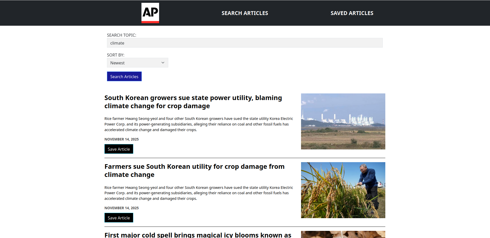

# About

This project is a MERN (Mongo-Express-React-Node) app that scrapes articles from New York Times. It is [deployed to render here](https://ap-scraper.onrender.com/). The purpose of developing this app is to practice with the fundamentals of full-stack web development and with various associated technology.

### Front-end Technology & Tools

* HTML/CSS
* ReactJS, react-bootstrap
* create-react-app
* axios for API interfacing

### Back-end and API Technology & Tools

* Express for websocket
* Node.js
* MongoDB Atlas/mongoose for json data storage
* axios for API interfacing
* cheerio for data scraping
* cors as middleware

### Additional Technology

* Docker for containerization

## Features

* Scrapes up to 20 articles at once.
* Information includes title, description, author, image when applicable, and link to the source.
* Form input for topic and sort method. 
* Saving feature for articles; saved articles are accessible until deleted.
* Visitors can comment on each saved article.
* UI is flexible for most screen sizes.

* Potential future feature: user database along with user authentication for user-linked comments
* Planned minor improvements: fix old dates from scraped data and add a return button for article comment threads

## Preview

